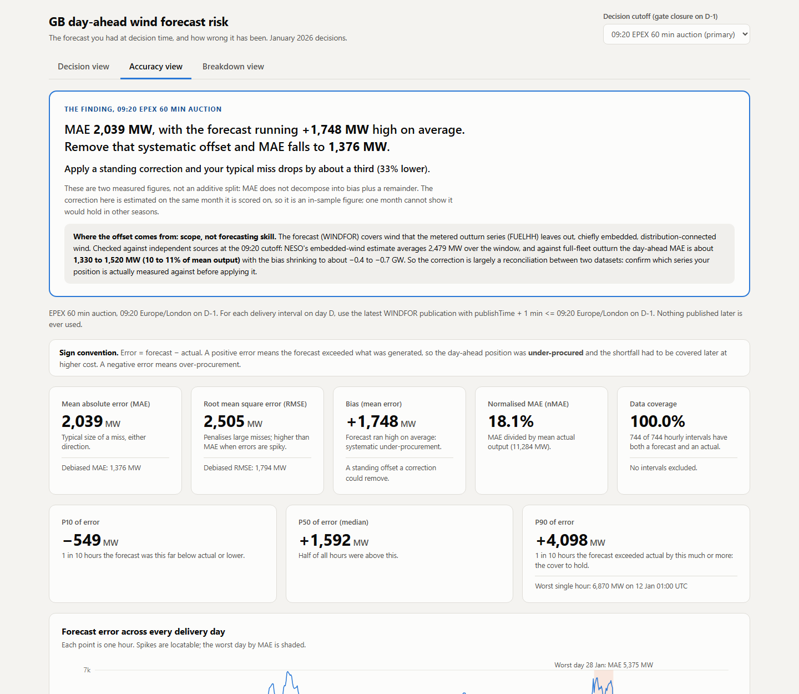
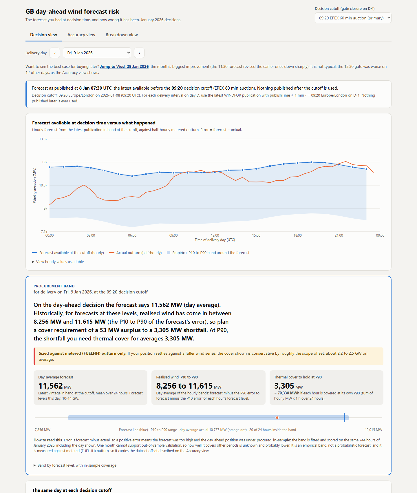
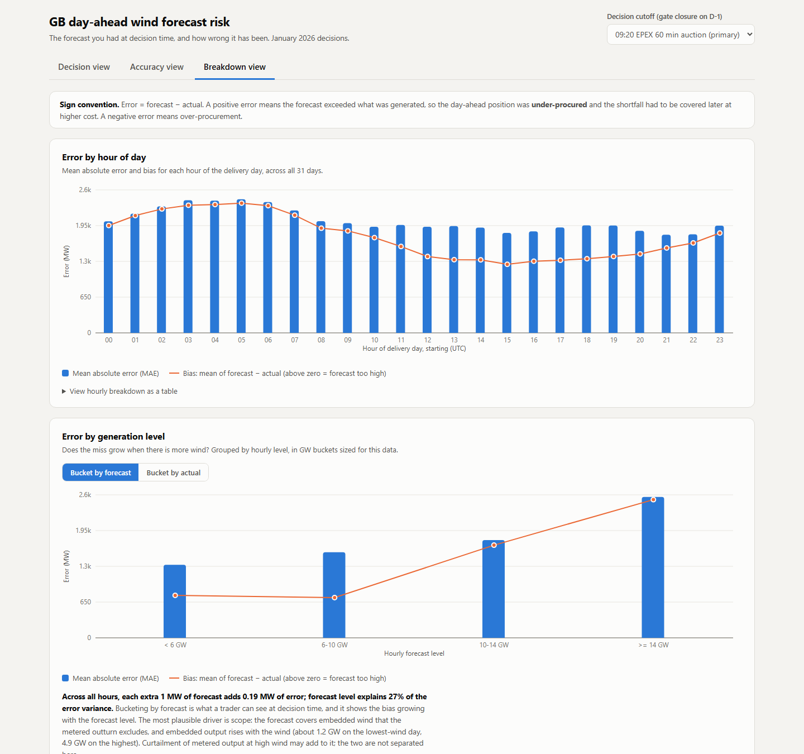

# GB day-ahead wind forecast risk

A utility buys electricity on the GB day-ahead market on D-1 for delivery on D. Wind is free but uncertain, and every
megawatt the forecast gets wrong has to be covered later at higher cost. This app shows the wind forecast that was
actually available at each day-ahead gate closure (never a later one), measures how wrong it has been over January 2026
decisions, and turns that error history into a band to size thermal cover around the forecast.

**Live demo: https://gb-wind-risk-x7q2.vercel.app** (API docs at `/api/docs`)

## Three findings

1. **We checked whether the forecast was broken, and found the comparison was broken instead.** Against FUELHH (metered,
   transmission-connected wind) the day-ahead error is about **2,039 MW, roughly 18%**. That is misleading: WINDFOR and FUELHH
   count different wind fleets. Against a fleet-matched outturn (Elexon's national wind series) the same forecast is off by about
   **1,330 MW, roughly 10%**. For a trading desk the point is practical: confirm which outturn series your position settles
   against, because benchmarking against the wrong one would have you applying a 1.7 GW standing correction you do not need.
2. **A procurement band sized to the forecast level.** For each hour, realised wind is expected between forecast minus P90 and
   forecast minus P10 of the error for hours with a similar forecast. P90 thermal cover runs from about 2.2 GW (forecasts under
   6 GW) to 4.7 GW (14 GW and above), with 78 to 80% in-sample coverage in every level bucket. It is in-sample on one month, and
   it is measured against FUELHH, so it inherits the offset in finding 1.
3. **Buying later helps modestly.** At the 15:30 gate MAE is 6.6% lower than at 09:20, but the 95% interval (−14.8% to +0.4%)
   reaches zero, so one month supports a directional case only. The 09:50 gate makes no difference.



## Data scope, and one deliberate exception

The application honours the two-dataset scope: Elexon **FUELHH** (actual wind) and **WINDFOR** (forecast) only. During analysis
the error looked implausibly high, so I went outside that scope for **one cross-check only**, to establish whether the forecast
was wrong or the comparison was. The cross-check used two other sources, Elexon's AGWS dataset (national wind generation) and
NESO's embedded-wind estimate. It lives in a standalone script, `scripts/scope_check.py`, not in the application, and it produced
the main finding. The application does not query those sources; it displays the check's results as fixed text labelled with the
cutoff they were computed at. Full evidence: [docs/ASSUMPTIONS.md](docs/ASSUMPTIONS.md) section 8.2.

## Screenshots

| Decision view | Breakdown view |
|---|---|
|  |  |

## Key numbers

All for the 31 delivery days 2 Jan to 1 Feb 2026 (744 hourly intervals, 100% coverage) against FUELHH. Error is forecast minus actual.

| | 09:20 EPEX 60 (primary) | 09:50 N2EX | 15:30 EPEX 30 |
|---|---|---|---|
| WINDFOR vintage used (UTC) | 07:30 | 09:30 | 11:30 (12:25 on one day) |
| MAE / RMSE | 2,039 / 2,505 MW | 2,013 / 2,506 MW | 1,904 / 2,361 MW |
| Bias | +1,748 MW | +1,730 MW | +1,693 MW |
| nMAE | 18.1% | 17.8% | 16.9% |
| P10 / P50 / P90 of error | −549 / +1,592 / +4,098 MW | −489 / +1,560 / +4,144 MW | −381 / +1,596 / +3,847 MW |

Same 09:20 forecast against different outturn series: FUELHH only MAE 2,039 MW (bias +1,748, nMAE 18.1%); FUELHH plus NESO
embedded wind 1,518 MW (−731, 11.0%); Elexon AGWS 1,330 MW (−418, 9.9%). Removing the +1,748 MW offset lowers MAE against
FUELHH to 1,376 MW, but that gain is the scope difference, not forecast skill: against the two fuller series the same step
improves MAE by only roughly 3% to 9%.

## Architecture

```
┌──────────────────────┐
│  Elexon BMRS API     │  (public, keyless)
└──────────┬───────────┘
           │  one-off ingestion: python -m app.ingest
           ▼
┌──────────────────────┐
│  data/raw/*.json     │  cached raw responses, committed
│  data/app.db         │  SQLite built from raw, committed
└──────────┬───────────┘
           │
┌──────────▼───────────┐
│  FastAPI backend     │  analytics computed from the snapshot, read-only
│  /api/*              │
└──────────┬───────────┘
           │  JSON
┌──────────▼───────────┐
│  React + Vite front  │  three views
└──────────────────────┘
```

The analysis window is fixed history, so the data is ingested once and **committed as a snapshot**: the deployed app
reads `data/app.db` read-only and makes no live call to Elexon. The numbers are byte-identical everywhere and cannot break
because a data provider is slow. `python -m app.ingest --refresh` re-fetches and rebuilds, so the live path exists but is not
on the request path. More in [docs/ARCHITECTURE.md](docs/ARCHITECTURE.md).

## Directory and file guide

| Path | Purpose |
|---|---|
| `backend/app/config.py` | Single source of truth: dates, decision cutoffs, publication lag, demo days, URLs, paths |
| `backend/app/ingest.py` | Fetch Elexon, cache raw responses to `data/raw/`, build `data/app.db` |
| `backend/app/storage.py` | Read-only SQLite access |
| `backend/app/align.py` | Forecast vintage selection (the no-lookahead rule) and hourly alignment |
| `backend/app/metrics.py` | MAE, RMSE, bias, percentiles, breakdowns, conditional band, cutoff comparison (pure functions) |
| `backend/app/schemas.py` | Typed API response models |
| `backend/app/main.py` | FastAPI app and routes |
| `backend/tests/` | `test_align.py` (no-lookahead), `test_metrics.py` (hand-computed formulas), `test_api.py` (contract) |
| `backend/requirements-dev.txt`, `backend/pyproject.toml` | Test and lint dependencies; tool configuration |
| `frontend/src/` | React app: `pages/` (three views), `components/` (panels and charts), `hooks/`, `lib/` |
| `frontend/Dockerfile`, `frontend/nginx.conf.template` | Static build served by nginx, proxying `/api` |
| `backend/Dockerfile`, `docker-compose.yml` | Backend image and the two-service compose file |
| `api/index.py`, `vercel.json` | Vercel serverless entry and routing |
| `requirements.txt` | Runtime dependencies for the API (Docker image and Vercel) |
| `data/raw/` | Cached raw Elexon responses (committed) |
| `data/app.db` | SQLite snapshot built from `data/raw/` (committed) |
| `docs/ASSUMPTIONS.md` | Every verified API fact, assumption, source and validation, with reasoning |
| `docs/ARCHITECTURE.md` | Data flow and design notes |
| `scripts/scope_check.py` | Standalone cross-check of the dataset offset against independent sources (needs network; not part of the app) |

## Running it

### Docker

> **Not verified.** The Dockerfiles and `docker-compose.yml` are provided, but the images were **not built or run** in the
> environment this project was written in (Docker was unavailable; last checked 24 Oct 2026). Treat `docker compose up --build`
> as untested until you have run it.

```
docker compose up --build        # then open http://localhost:3000
```

### Manually (verified)

Python 3.11 or 3.12 and Node 20 or later.

```
python -m venv .venv
source .venv/bin/activate        # Windows: .venv\Scripts\activate
pip install -r backend/requirements-dev.txt

cd backend
python -m uvicorn app.main:app --port 8000          # API at http://127.0.0.1:8000/api/docs
```

```
cd frontend
npm ci
npm run dev                                          # http://localhost:5173, proxies /api to port 8000
```

Refresh the data (optional; needs network): `cd backend && python -m app.ingest --refresh`. Re-running without `--refresh`
makes no network calls but does rebuild `data/app.db`.

Deploy: `npx vercel login` then `npx vercel deploy --prod` from the repository root.

## Design decisions and assumptions

Full reasoning is in [docs/ASSUMPTIONS.md](docs/ASSUMPTIONS.md). The ones to know:

- **No lookahead.** For each delivery hour the forecast is the latest WINDFOR publication with
  `publishTime + 1 minute <= cutoff` on D-1. Nothing later is ever used, and if nothing earlier exists the hour is reported
  missing rather than falling back. The 1 minute lag is deliberate conservatism: a forecast stamped 15:30:00 is not on the
  desk of someone submitting into a 15:30:00 gate.
- **Cutoffs are real gate closures**, in Europe/London time on D-1: 09:20 (EPEX SPOT GB 60 minute auction, primary), 09:50
  (Nord Pool N2EX) and 15:30 (EPEX SPOT GB 30 minute auction). All metrics are computed at all three and compared in the UI.
- **Native resolution.** WINDFOR is hourly and FUELHH is half-hourly, so the two half-hours inside each forecast hour are
  averaged (mean of MW, never a sum) and the forecast is never interpolated.
- **No MAPE**, because wind output approaches zero.
- **Committed snapshot** rather than live calls, as described above.

## Known limitations

- **Scope.** FUELHH excludes embedded wind, so against it the forecast runs high; against fuller series it is slightly low.
  The app reports FUELHH-based figures (evaluating the forecast as published) and states the offset on screen. The two fuller
  series are the closest available match, not a perfect one, and WINDFOR's exact fleet definition was inferred from the numbers,
  not from documentation.
- **One month.** The band and the cutoff comparison are estimated and scored on January 2026. They are in-sample, and one month
  cannot show they hold in other seasons. The procurement band inherits the FUELHH offset.
- **Availability time.** `publishTime` is assumed to be when a forecast reaches the desk. The data cannot show real latency.
- **Gate times** come from EPEX SPOT and Nord Pool documentation (sources in `docs/ASSUMPTIONS.md` section 4) and were not
  re-checked for changes after 2024. The 15:30 conclusion is statistically weak on one month.
- **Daylight saving.** January has no clock change, so the scope is unaffected, but the time handling should be audited
  before extending to March or October.
- Docker images are untested (see above). There are no front-end automated tests.

## Testing

```
cd backend
python -m pytest        # 61 tests
python -m ruff check .
```

`test_align.py` covers the no-lookahead rule (vintage selection at each gate, equality at the cutoff, no fallback to a later
vintage, a 600-case brute-force check, and the real snapshot at all three cutoffs). `test_metrics.py` checks each formula
against hand-computed values. `test_api.py` checks the endpoints, the echoed cutoff rule and clean error responses.

## AI tool disclosure

AI tools assisted in building this project.
